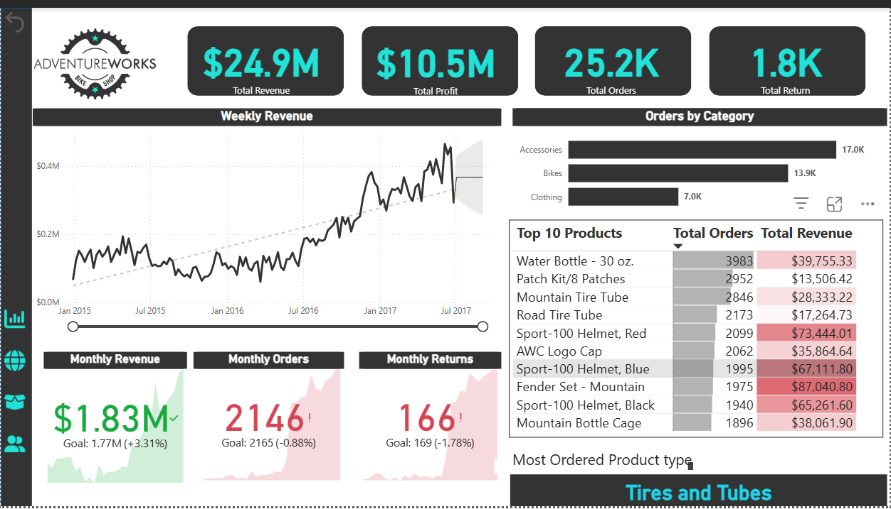
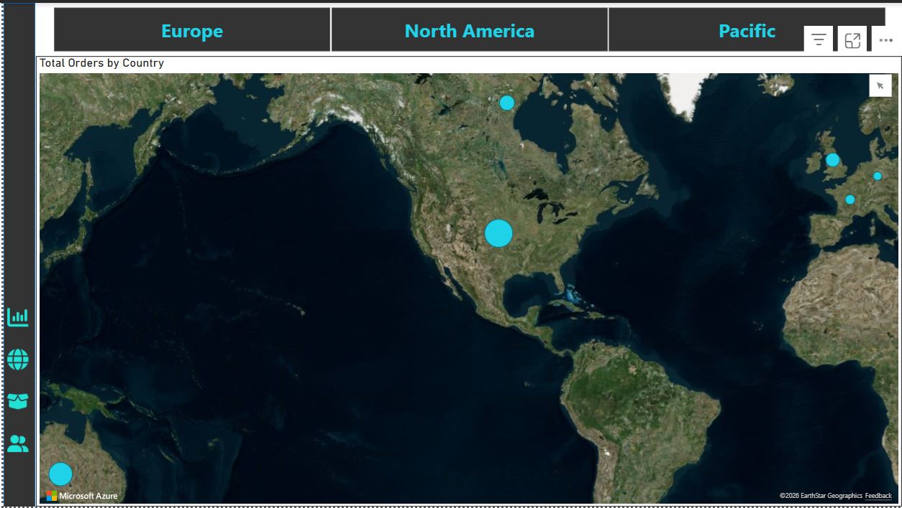
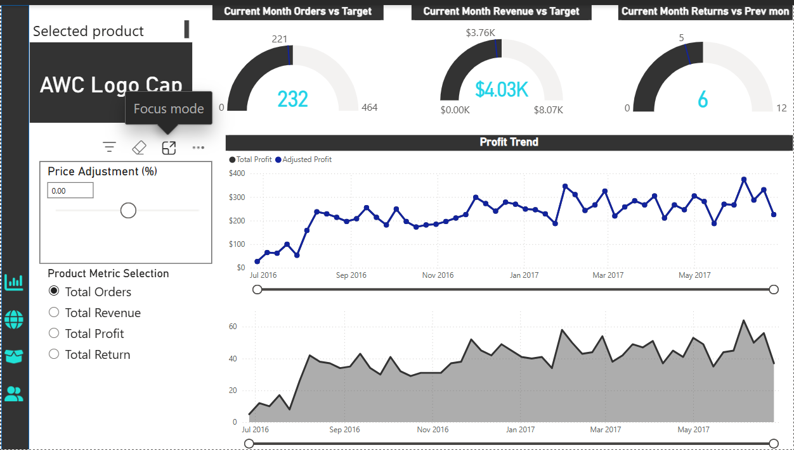
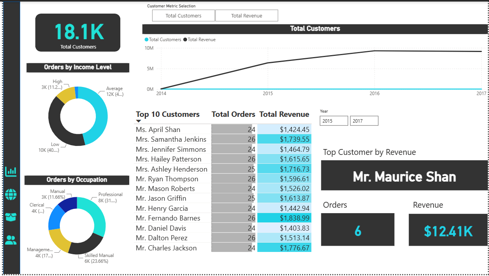

# 🚲 AdventureWorks Sales, Product & Customer Analytics Dashboard

An end-to-end Business Intelligence project analyzing global sales performance, regional distribution, product metrics, and customer demographics for AdventureWorks using Power BI

## 📊 Project Overview
This dashboard suite provides deep insights into revenue generation, profit margins, order volumes, product trends, and customer purchasing behaviors across multiple international markets

## 🚀 Key Features & Report Pages
1. **Sales Overview:** High-level KPIs tracking total revenue ($24.9M), total profit ($10.5M), total orders (25.2K), and returns with weekly/monthly trend analysis.
2. **Geographic Analysis:** Interactive map breakdown of order distribution across European, North American, and Pacific markets.
3. **Product Performance:** Detailed analysis of top-performing products, price adjustment simulation tools, and profit trend monitoring.
4. **Customer Analysis:** Segmentation by income level and occupation, highlighting top customers (e.g., Mr. Maurice Shan) and lifetime revenue contributions.

## 🛠️ Tools & Technologies Used
* **Power BI Desktop:** Data modeling, DAX measures, interactive filtering, and custom page layouts.
* **Power Query:** Data extraction, transformation, and cleansing.
* **GitHub:** Version control and project documentation.

### Sales Overview

### Geographic Analysis

### Product Performance

### Customer Analysis

## 📂 Repository Structure
* `/dashboard` — Contains the `.pbix` Power BI source file.
* `/screenshots` — High-resolution previews of each dashboard tab.
* `/data` — Raw dataset files used for the analysis.
